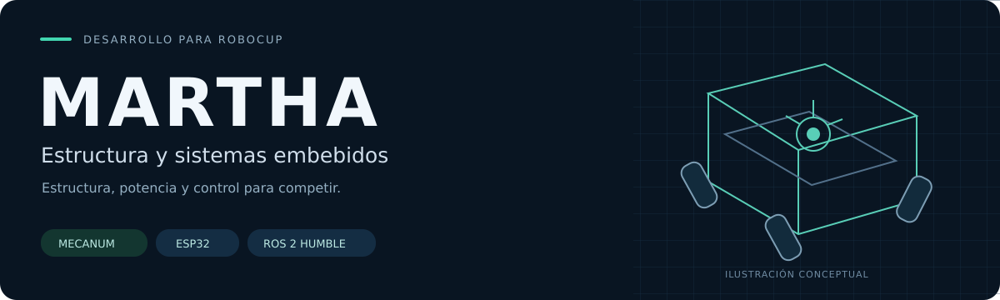
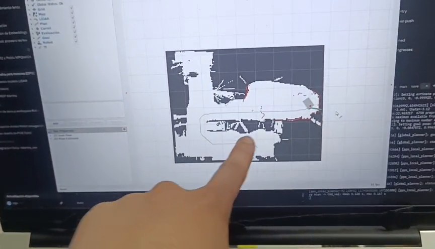
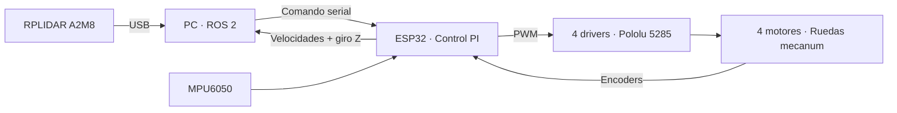

<p align="center">
  
</p>

<p align="center">
  <a href="docs/hardware/electrica/README.md"><strong>Eléctrica</strong></a> ·
  <a href="firmware/README.md"><strong>Firmware</strong></a> ·
  <a href="ros2_ws/src/andesrobot_description/docs/ROBOT.md"><strong>Modelo (URDF)</strong></a> ·
  <a href="docs/hardware/bom/README.md"><strong>Materiales</strong></a> ·
  <a href="docs/evidencias/README.md"><strong>Ver el robot</strong></a>
</p>

<div align="center">


-E95420?logo=ubuntu&logoColor=white)

Equipo de **Estructura y Electrónica** de AndesRobot · Colombia

</div>

# Una base móvil, cuatro ruedas, un sistema integrado

**MARTHA** combina una base mecanum, control de motores con ESP32 y sensores conectados a ROS 2.
Aquí está todo lo de Estructura: la electrónica, el firmware del ESP32, el modelo del robot (URDF)
y los paquetes ROS de la base. Sigue el mismo orden que
[`milo_ws`](https://github.com/alejapinzonf/milo_ws) (el workspace de Milo) y la
[arquitectura ROS 2 de AndesRobot](https://alejapinzonf.github.io/Robot_arquitecture_ROS2/):
Estructura es dueña de los motores, los encoders, la IMU, la odometría (`/base/odom`), los botones,
las luces y `robot_state_publisher`. La navegación está en el repo
[Navegation](https://github.com/AndesRobot-Oficial/Navegation).

<table>
<tr>
<td width="50%"><a href="docs/evidencias/README.md"></a></td>
<td width="50%"><a href="docs/evidencias/README.md"></a></td>
</tr>
<tr><td align="center"><strong>La plataforma física</strong><br>Estructura, electrónica y cómputo a bordo.</td><td align="center"><strong>El sistema en operación</strong><br>Mapa y seguimiento de ruta en RViz.</td></tr>
</table>

## La plataforma en cifras

| Tracción y control | Sensores y alimentación |
|---|---|
| **4 ruedas mecanum** · diámetro de 150 mm | **RPLIDAR A2M8** · medición del entorno (lo configura Navegación) |
| **4 Pololu 4753** · motor nominal de 12 V, reducción 50:1 | **MPU6050** · velocidad angular |
| **4 Pololu 5285** · drivers MPQ6612A | **Batería documentada como 15 V** · capacidad por confirmar |
| **ESP32 DevKit/WROOM** · control de la base | **PC a bordo** · USB para ESP32 y LiDAR, ROS 2 Humble |

## Del comando al movimiento



El ESP32 controla las ruedas y reporta velocidades. El PC fusiona la odometría con la IMU (EKF)
y recibe las mediciones del LiDAR. Hoy el PC y el ESP32 hablan por un protocolo serial propio
([ver protocolo →](docs/integracion_ros2/README.md)); lo planeado es pasar a micro-ROS.

---

## Contenido

1. [Instalar (una vez por computador)](#1-instalar-una-vez-por-computador)
2. [El modelo de Martha](#2-el-modelo-de-martha)
3. [Martha física](#3-martha-física)
4. [Todos los comandos](#4-todos-los-comandos)
5. [Qué hay en el repo](#5-qué-hay-en-el-repo)
6. [El contrato: lo que publica Estructura](#6-el-contrato-lo-que-publica-estructura)
7. [Estado y lo que falta](#7-estado-y-lo-que-falta)

> Lo de ROS corre dentro de **Docker** (Ubuntu 22.04 + ROS 2 Humble), así que funciona igual en
> cualquier Ubuntu. Tu código vive en tu PC (`ros2_ws/`) y el contenedor lo ve como `/ros2_ws`:
> editas en tu PC y compilas/corres dentro de Docker con `./sim.sh` o `./robot.sh`.

---

## 1. Instalar (una vez por computador)

### Docker

```bash
sudo apt update
sudo apt install -y docker.io docker-compose-v2 docker-buildx git x11-xserver-utils
sudo usermod -aG docker $USER
```

Después **reinicia** el computador (o cierra sesión y vuelve a entrar). Para ver si quedó bien:

```bash
docker run --rm hello-world
```

Tiene que decir `Hello from Docker!`. Si dice *permission denied*, falta reiniciar.

<details>
<summary><b>Solo si tu computador tiene tarjeta NVIDIA</b> (clic para ver)</summary>

```bash
curl -fsSL https://nvidia.github.io/libnvidia-container/gpgkey | sudo gpg --dearmor -o /usr/share/keyrings/nvidia-container-toolkit-keyring.gpg
curl -s -L https://nvidia.github.io/libnvidia-container/stable/deb/nvidia-container-toolkit.list | sed 's#deb https://#deb [signed-by=/usr/share/keyrings/nvidia-container-toolkit-keyring.gpg] https://#g' | sudo tee /etc/apt/sources.list.d/nvidia-container-toolkit.list
sudo apt update
sudo apt install -y nvidia-container-toolkit
sudo nvidia-ctk runtime configure --runtime=docker
sudo systemctl restart docker
```

Sin esto igual funciona, pero RViz dibuja con la CPU.
</details>

### El repo

Los dos repos de Martha van uno al lado del otro, en la misma carpeta:

```bash
mkdir -p ~/AndesRobot && cd ~/AndesRobot
git clone https://github.com/AndesRobot-Oficial/Structure-Embedded-Systems_MATHA.git
git clone https://github.com/AndesRobot-Oficial/Navegation.git
```

> La **primera vez** que corras `./sim.sh` se demora harto (15-30 min): construye la imagen de
> Docker `martha:humble` y compila. Es la misma imagen del repo de Navegación: si ya la
> construiste allá, aquí parte en segundos.

### Para el firmware (Arduino)

```bash
curl -fsSL https://raw.githubusercontent.com/arduino/arduino-cli/master/install.sh | BINDIR=~/.local/bin sh
```

```bash
arduino-cli core update-index --additional-urls https://espressif.github.io/arduino-esp32/package_esp32_index.json && arduino-cli core install esp32:esp32 --additional-urls https://espressif.github.io/arduino-esp32/package_esp32_index.json
```

Detalles en [firmware](firmware/README.md).

---

## 2. El modelo de Martha

```bash
cd ~/AndesRobot/Structure-Embedded-Systems_MATHA
./sim.sh
```

Abre RViz con el URDF de Martha tal como está construida: chasis, ruedas, LiDAR, IMU y la torre de
aluminio. `./sim.sh mecanum` muestra las ruedas con sus rodillos. Medidas, frames y argumentos en
[ROBOT.md](ros2_ws/src/andesrobot_description/docs/ROBOT.md).

> **El URDF vive aquí y Navegación tiene una copia** para su simulación en Gazebo. Si lo cambias,
> copia la carpeta `ros2_ws/src/andesrobot_description` completa a
> `../Navegation/ros2_ws/src/` y haz el commit allá diciendo de qué commit de este repo viene.

Las pruebas del URDF (que se pueda expandir y que no tenga "dos puntos + espacio", que rompe
ros2_control) corren con `./sim.sh pruebas`.

---

## 3. Martha física

### Puertos fijos para el ESP32 y el LiDAR (una vez, en el laptop de Martha)

El ESP32 y el RPLIDAR usan el mismo chip USB-serie y Linux los numera en cualquier orden. Las
reglas de [docker/udev](docker/udev/README.md) les dan nombres fijos: **`/dev/martha_esp32`** y
**`/dev/martha_lidar`**. Para ver los números de serie: `./robot.sh puertos`.

### Cargar el firmware

Con el ESP32 conectado al PC (en el laptop de Martha o en el tuyo):

```bash
arduino-cli compile --fqbn esp32:esp32:esp32doit-devkit-v1 firmware
```

```bash
arduino-cli upload --fqbn esp32:esp32:esp32doit-devkit-v1 -p /dev/martha_esp32 firmware
```

### Probar la base sin ROS

```bash
./robot.sh serial
```

Es una terminal con el ESP32: al arrancar responde `ready`; escribe `cmd_vel,0.1,0,0` y las ruedas
avanzan (si no llega otro comando en 500 ms, se detienen); el ESP32 responde `odom,vx,vy,wz,gz`
50 veces por segundo. Salir: `Ctrl+]`. Hazlo **con las ruedas en el aire** y sigue la
[puesta en marcha](docs/puesta_en_marcha.md).

> **Sin protecciones todavía:** el divisor de batería y el comparador de sobrecorriente no están
> soldados, así que el firmware no detiene el robot con batería baja ni con un motor trabado.

---

## 4. Todos los comandos

Todos desde la carpeta del repo.

| Comando | Qué hace |
|---|---|
| `./sim.sh` | el modelo de Martha en RViz |
| `./sim.sh mecanum` | igual, con las ruedas mecanum y sus rodillos |
| `./sim.sh pruebas` | pruebas (pytest) de los paquetes ROS |
| `./sim.sh shell` / `build` / `stop` | terminal en el contenedor / recompilar / apagar |
| `./sim.sh cpu` / `software` / `gpu` | sin NVIDIA / RViz negro / con qué tarjeta dibuja |
| `./robot.sh` | (laptop de Martha) contenedor con acceso a los USB |
| `./robot.sh puertos` | los puertos USB conectados, para las reglas udev |
| `./robot.sh serial` | terminal serial con el ESP32 (`ESP32=/dev/ttyUSB0` sin udev) |
| `./robot.sh shell` / `build` / `stop` | igual que en `sim.sh`, en modo robot |

---

## 5. Qué hay en el repo

```text
Structure-Embedded-Systems_MATHA/
├── sim.sh                     el modelo y las pruebas, en tu PC
├── robot.sh                   en el laptop de Martha (USB del ESP32 y del LiDAR)
├── docker/                    la imagen martha:humble (copia exacta de la de Navegación, salvo
│   │                          compose.yaml) y el micro-ROS agent
│   └── udev/                  nombres fijos /dev/martha_esp32 y /dev/martha_lidar
├── firmware/                  sketch del ESP32 (control PI, encoders, IMU, protocolo serial) y
│                              sketches de prueba para la puesta en marcha
├── docs/
│   ├── hardware/              todo lo físico
│   │   ├── electrica/         diagramas, pines y conexiones, presupuesto de potencia, revisión
│   │   ├── bom/               materiales y compras
│   │   ├── cad/               geometría y estado del diseño mecánico
│   │   └── pcb/               estado de los archivos de fabricación
│   ├── integracion_ros2/      puente serial, EKF y LiDAR de la tesis (copias de referencia)
│   ├── evidencias/            fotos y videos del robot funcionando
│   ├── fuentes_tesis/         fragmentos LaTeX de la tesis
│   ├── puesta_en_marcha.md    comprobaciones antes de operar
│   └── estado_y_pendientes.md lo que falta y las diferencias entre fuentes
└── ros2_ws/src/
    └── andesrobot_description   URDF de Martha (Navegación tiene una copia)
```

---

## 6. El contrato: lo que publica Estructura

Navegación y Estructura se conectan solo por estos tópicos. Navegación nunca toca un motor.

| Interfaz | Tipo | Quién | Hoy |
|---|---|---|---|
| `/cmd_vel` | `geometry_msgs/Twist` (`linear.x`, `linear.y`, `angular.z`) | Navegación → Estructura | el puente serial lo pasa al ESP32 |
| `/base/odom` + TF `odom → base_footprint` | `nav_msgs/Odometry` | Estructura | EKF de ruedas + IMU (con los nombres de la tesis, falta pasarlos al contrato) |
| `/base/imu` | `sensor_msgs/Imu` | Estructura | giro Z del MPU6050 |
| `/base/emergency_stop`, `/base/start_button`, `/base/set_led_state` | | Estructura | falta |
| `/tf_static` (URDF) | | Estructura (`robot_state_publisher`) | `andesrobot_description` |

Si `/cmd_vel` deja de llegar 0,5 s, la base se detiene (el firmware ya lo hace).

---

## 7. Estado y lo que falta

| Disponible | Por completar |
|---|---|
| Firmware que funciona en el robot (c8faa84) y sketches de prueba | Soldar el divisor de batería y el comparador de sobrecorriente |
| Siete diagramas eléctricos, inventario, pines y conexiones | CAD nativo y archivos de fabricación de PCB |
| URDF de Martha tal como está construida | Consumos medidos y datos completos de batería |
| Fotografías e inventario de pruebas físicas | Paquete `andesrobot_bringup`: la base en ROS con los nombres del contrato |

Lo que viene en ROS, en este orden aproximado (como `andesrobot_bringup` y `drivers/` de milo_ws):

1. Firmware con micro-ROS: el ESP32 publica `/base/imu` y el estado de cada rueda.
2. ros2_control en el laptop (`topic_based_ros2_control` + `mecanum_drive_controller`) →
   `/base/wheel_odom`; EKF (`robot_localization`) → `/base/odom`.
3. Botón de emergencia, botón de inicio y luces con sus nodos.

Detalle en [estado y pendientes](docs/estado_y_pendientes.md).

---

[Procedencia de los archivos](docs/procedencia.md) · [Cómo subir cambios](docs/publicacion.md)
