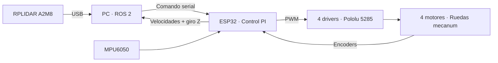

<p align="center">
  
</p>

<p align="center">
  <a href="electrica/README.md"><strong>Eléctrica</strong></a> ·
  <a href="firmware/README.md"><strong>Firmware</strong></a> ·
  <a href="bom/README.md"><strong>Materiales</strong></a> ·
  <a href="docs/evidencias/README.md"><strong>Ver el robot</strong></a>
</p>

# Una base móvil, cuatro ruedas, un sistema integrado

**MARTHA** combina una base mecanum, control de motores con ESP32 y sensores conectados a ROS 2. Aquí se reúne la documentación de su estructura y electrónica: qué componentes utiliza, cómo se conectan y cómo se comunica el control con el PC a bordo.

<table>
<tr>
<td width="50%"><a href="docs/evidencias/README.md"></a></td>
<td width="50%"><a href="docs/evidencias/README.md"></a></td>
</tr>
<tr><td align="center"><strong>La plataforma física</strong><br>Estructura, electrónica y cómputo a bordo.</td><td align="center"><strong>El sistema en operación</strong><br>Mapa y seguimiento de ruta en RViz.</td></tr>
</table>

## Explora el proyecto

| Construcción | Control e integración | Pruebas y documentación |
|---|---|---|
| **[Diagramas eléctricos](electrica/esquematicos/README.md)**<br>Alimentación, motores y sensores. | **[Firmware ESP32](firmware/README.md)**<br>PI, encoders y cinemática mecanum. | **[Galería de evidencias](docs/evidencias/README.md)**<br>21 imágenes y enlaces a videos. |
| **[Materiales y compras](bom/README.md)**<br>Referencias, cantidades y costos históricos. | **[Integración ROS 2](integracion_ros2/README.md)**<br>Serial, odometría, IMU y LiDAR. | **[Puesta en marcha](docs/puesta_en_marcha.md)**<br>Comprobaciones de montaje y operación. |
| **[Mecánica](cad/README.md) · [PCB](pcb/README.md)**<br>Geometría y originales por recuperar. | **[Pines y conexiones](electrica/cableado/README.md)**<br>Asignación GPIO y tabla de conexiones. | **[Estado y pendientes](docs/estado_y_pendientes.md)**<br>Diferencias entre las fuentes disponibles. |

## Del comando al movimiento



El ESP32 controla las ruedas y reporta velocidades. El PC fusiona la odometría con la IMU y recibe las mediciones del LiDAR. [Ver el protocolo y las configuraciones →](integracion_ros2/README.md)

## La plataforma en cifras

| Tracción y control | Sensores y alimentación |
|---|---|
| **4 ruedas mecanum** · diámetro de 150 mm | **RPLIDAR A2M8** · medición del entorno |
| **4 Pololu 4753** · motor nominal de 12 V, reducción 50:1 | **MPU6050** · velocidad angular |
| **4 Pololu 5285** · drivers MPQ6612A | **Batería documentada como 15 V** · capacidad por confirmar |
| **ESP32 DevKit/WROOM** · control de la base | **PC a bordo** · USB para ESP32 y LiDAR, ROS 2 Humble |

## Estado de esta entrega

| Disponible | Por completar |
|---|---|
| Siete diagramas eléctricos originales | CAD nativo y archivos de fabricación de PCB |
| Inventario, pines y conexiones documentados | Consumos medidos y datos completos de batería |
| Firmware e interfaces ROS como referencia | Confirmar la revisión final utilizada en el robot |
| Fotografías e inventario de pruebas físicas | Resolver diferencias de calibración y protecciones |

> **Antes de operar:** el firmware incluido es una copia de referencia y difiere de la revisión descrita en la tesis. El diagrama adicional con dos RealSense se conserva como variante; su uso en las pruebas no está confirmado. Consulta [estado y pendientes](docs/estado_y_pendientes.md).

<details>
<summary><strong>Organización del repositorio</strong></summary>

```text
├── bom/                 Materiales y compras
├── cad/                 Geometría y estado del diseño mecánico
├── electrica/           Diagramas, conexiones y revisión eléctrica
├── firmware/            Sketch ESP32 y documentación
├── integracion_ros2/    Puente serial y configuraciones
├── pcb/                 Estado de los archivos de fabricación
└── docs/                Evidencias, fuentes y guías
```

</details>

---

[Procedencia de los archivos](docs/procedencia.md) · [Historial de cambios](CHANGELOG.md) · [Cómo subir cambios](docs/publicacion.md)

El software completo de navegación se mantiene en **[martha_nav](https://github.com/Mocolax/martha_nav)**. Este repositorio concentra estructura y sistemas embebidos; no incluye URDF ni un paquete ROS instalable independiente.
