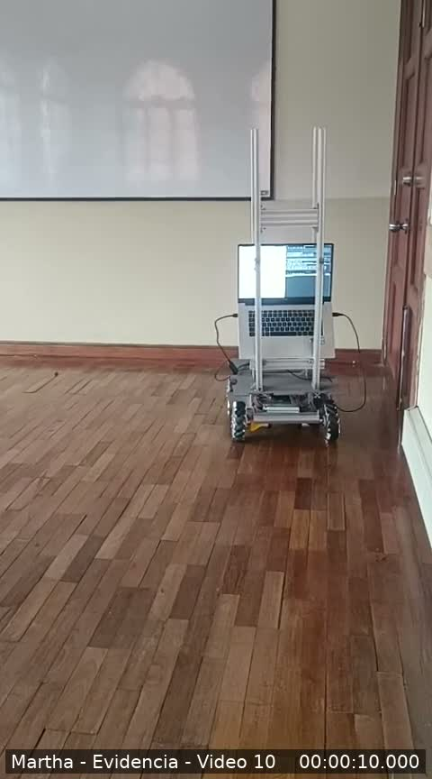
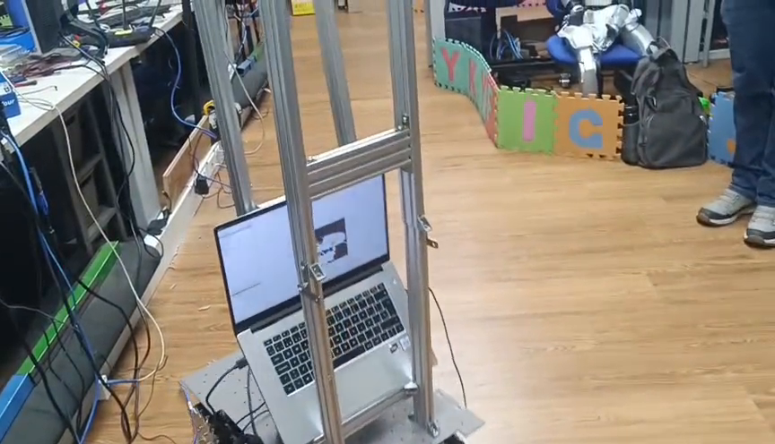
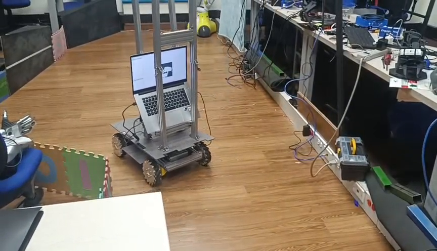

[← Inicio](../../README.md)

# MARTHA · Fotos y video

Registro visual de la plataforma: estructura de aluminio, computador a bordo y base móvil. Esta galería reúne los cuatro archivos fotográficos seleccionados por el equipo y un video de demostración.

## Video de la plataforma

<a href="videos/martha_demostracion.mp4"><strong>Abrir o descargar el video de MARTHA</strong></a>

**Duración:** 50,9 s · **Formato:** MP4, H.264/AAC · **Resolución:** 480 × 864 · **Tamaño:** 11,0 MB.

El video se conserva íntegro; únicamente se cambió su nombre a `martha_demostracion.mp4`. La portada es un fotograma del segundo 10. El enlace permite acceder al archivo; no depende de que GitHub muestre un reproductor dentro del README.

## Galería

| MARTHA · Vista 1 | MARTHA · Vista 2 |
|:---:|:---:|
|  |  |
| **MARTHA · Vista 3** | **Preparación de la plataforma** |
|  |  |

Las imágenes se conservan con sus nombres originales. Los próximos registros podrán documentar montaje, integración y pruebas del proyecto RoboCup.
