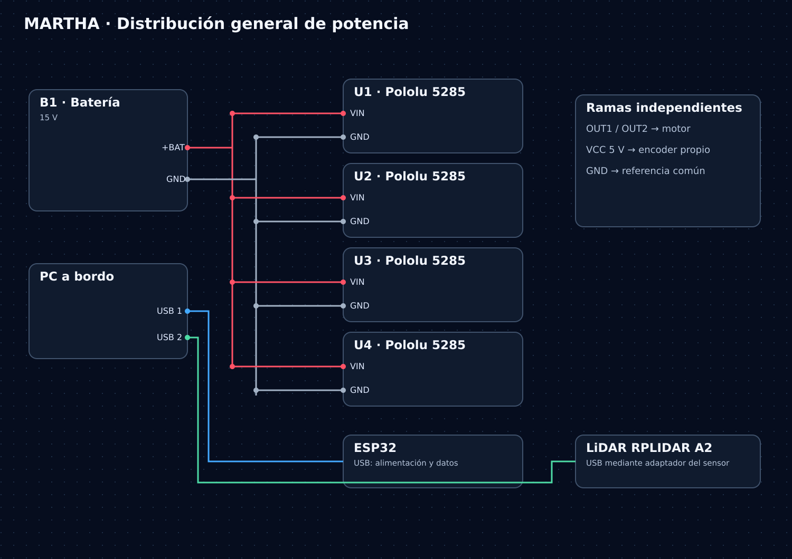

[← Inicio](../../../README.md)

# Eléctrica

**De la batería a cada rueda:** distribución de potencia, control y conexiones de la base MARTHA.

| Consultar el diseño | Preparar el montaje |
|---|---|
| **[Atlas de diagramas](esquematicos/README.md)** Vista general, cuatro motores y sensores. | **[Pines y conexiones](cableado/README.md)** Asignación GPIO y señales compartidas. |
| **[Tabla de conexiones CSV](cableado/tabla_conexiones.csv)** Origen, destino y observaciones. | **[Revisión eléctrica](revision_plano.md)** Diferencias y datos que falta verificar. |
| **[Materiales](../bom/README.md)** Componentes y cantidades. | **[Presupuesto de potencia](presupuesto_potencia.csv)** Plantilla con consumos pendientes de medición. |

## Dominios de alimentación

| Dominio | Alimenta | Dato documentado |
|---|---|---|
| Batería | Cuatro drivers de motor | 15 V; rango real y capacidad pendientes |
| Salidas de drivers | Motores y encoders asociados | Motores nominales de 12 V; encoders a 5 V en el diagrama |
| USB del PC | ESP32 y LiDAR | Alimentación y datos |

Los PNG son diagramas de conexión aportados por el equipo. Los originales editables de la PCB, calibres, protecciones y adaptaciones de nivel se describen en [revisión eléctrica](revision_plano.md).
