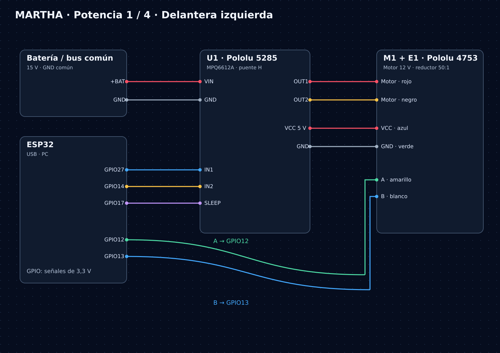
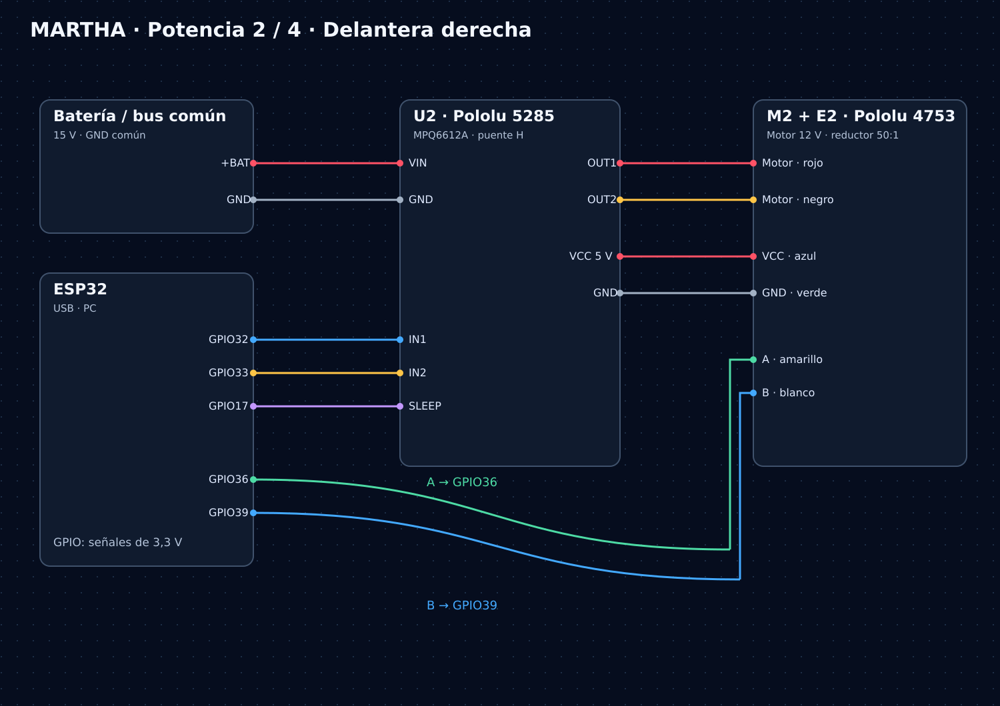
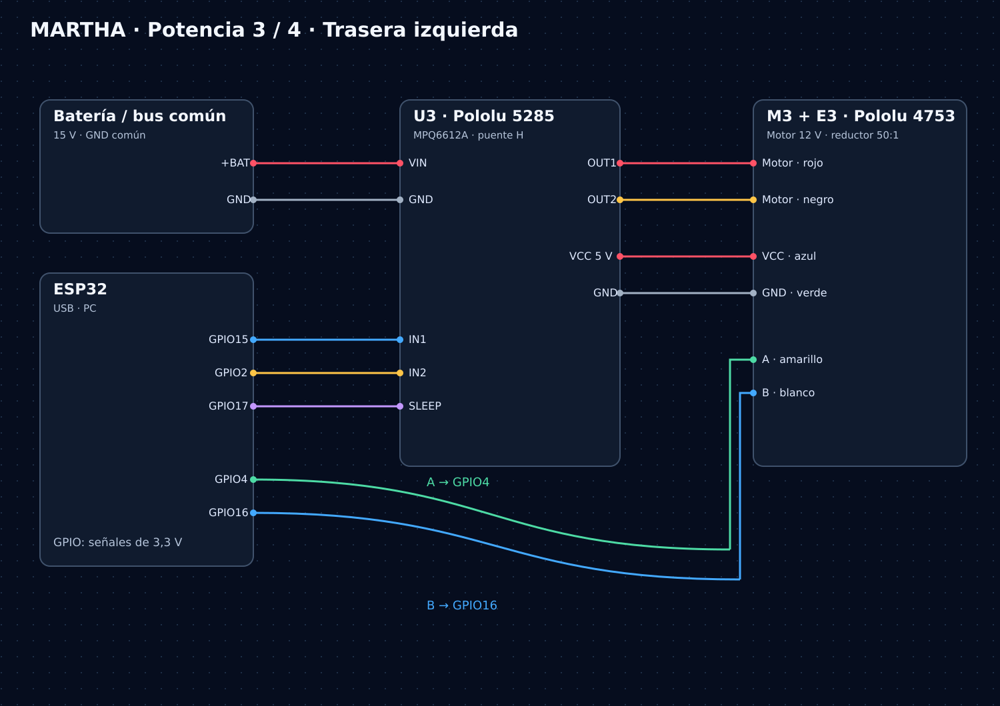
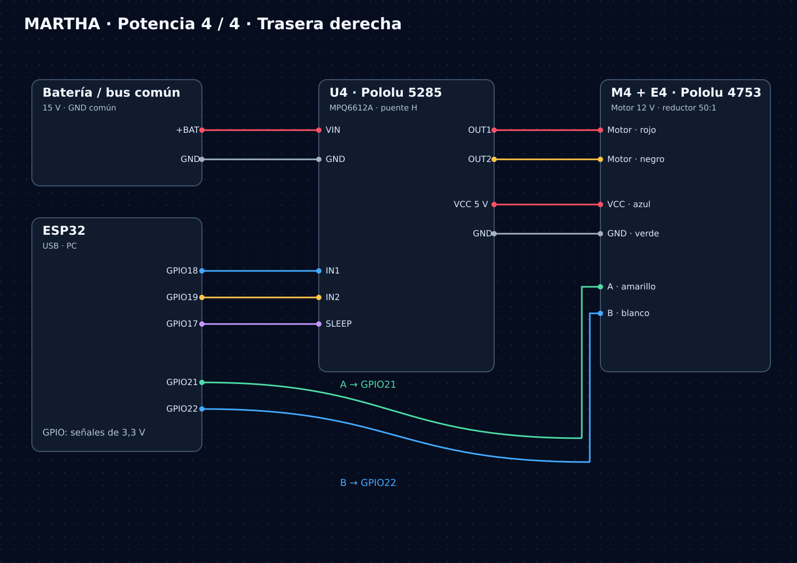
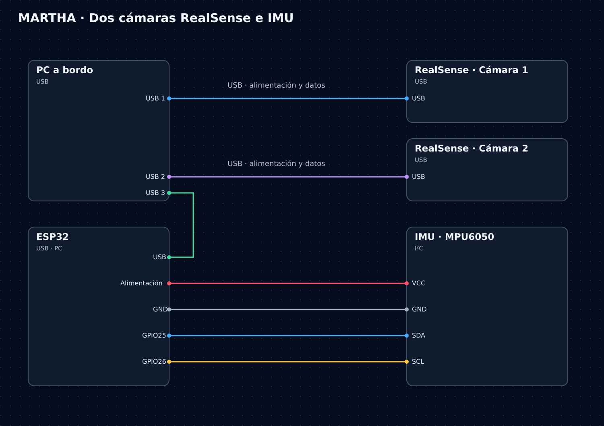

[← Eléctrica](../README.md) · [Inicio](../../README.md)

# Atlas de conexiones

**Siete diagramas para recorrer la alimentación, la tracción y los sensores de MARTHA.** Selecciona una imagen para abrirla a tamaño completo.

[Distribución](#distribución-general) · [Motores](#las-cuatro-ruedas) · [Sensores](#sensores) · [Plano completo](martha_potencia_completa.png)

## Distribución general

La batería alimenta los cuatro drivers. El PC suministra alimentación USB al ESP32 y al LiDAR.

## Las cuatro ruedas

| Delantera izquierda · M1 | Delantera derecha · M2 |
|:---:|:---:|
|  |  |
| **Trasera izquierda · M3** | **Trasera derecha · M4** |
|  |  |

[Ver las cuatro ramas en un solo plano →](martha_potencia_completa.png) · [Consultar GPIO y conexiones →](../cableado/README.md)

## Sensores

Esta lámina incluye dos RealSense y la MPU6050. Las cámaras se conservan como variante documentada; no se afirma su participación en las pruebas de la tesis.

---

**Originales conservados:** los siete PNG mantienen su contenido y nombre. La secuencia original pasa de 05 a 07. Los dibujos no detallan todos los elementos de protección ni la adaptación de niveles de encoder: consultar [revisión eléctrica](../revision_plano.md) antes de usarlos para el montaje.
